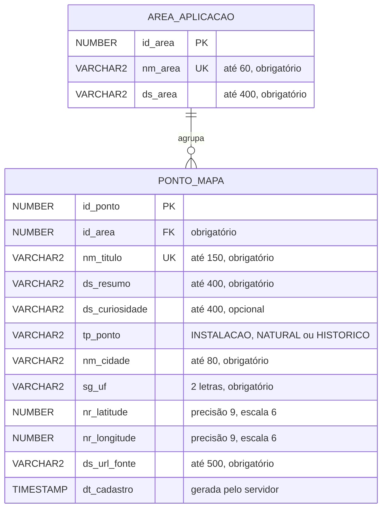

# Expedição Átomo: API do Mapa Nuclear

Esta API REST alimenta o mapa do app Expedição Átomo. Ela guarda as cinco áreas de aplicação citadas pelo CTMSP e 11 lugares reais do Brasil onde a tecnologia nuclear aparece, e todo ponto traz o link da fonte oficial que sustenta o texto.

Entrega de Java Advanced da Sprint 1 do Challenge FIAP 2026, feito com o Centro Tecnológico da Marinha em São Paulo (CTMSP).

## Integrantes

Grupo Expedição Átomo, 2TDSPS

| Nome | RM |
|---|---|
| Raphael Oliveira Sinelli Mendonça | 568346 |
| Arthur Lins Belarmino | 566845 |
| Henrique Spoltore Moreno Pavão dos Santos | 568130 |

## O problema

O brasileiro desconfia de uma tecnologia que já usa, e a escola, que deveria mostrar benefícios e riscos, fala pouco do tema e mais da bomba do que do hospital.

- Desconfiança: na pesquisa do Nuclear Confidence Project noticiada pela [Petronotícias em 04/08/2026](https://petronoticias.com.br/estudo-revela-que-maioria-da-populacao-brasileira-ainda-desconhece-avancos-e-beneficios-da-geracao-de-energia-nuclear/), 29% dos entrevistados apoiam projetos nucleares e 40% se opõem. 88% se dizem preocupados com a segurança, e só 44,9% sabem que a nuclear tem baixa emissão de carbono.
- Pouca informação: uma [tese da ECA/USP (Machado, 2021)](https://teses.usp.br/teses/disponiveis/27/27154/tde-30082021-113842/) concluiu que a maioria tem medo da energia nuclear, não consumiria alimento irradiado e não se informa regularmente sobre o setor.
- Uso real: segundo a [CNEN](https://www.gov.br/cnen/pt-br/rmb/os-avancos-para-a-saude-publica-no-brasil), o Brasil faz cerca de 2 milhões de procedimentos com radiofármacos por ano, um terço da necessidade, e o tecnécio-99m está em 80% deles.
- Escola: a [habilidade EM13CNT103 da BNCC](https://profez.com.br/bncc/ciencias-da-natureza-e-suas-tecnologias/1-ano-em/em13cnt103) pede que o aluno avalie potencialidades e riscos das radiações no cotidiano, na saúde, no ambiente, na indústria, na agricultura e na geração de energia. Um [estudo de Sousa e Silva Filho no VII SENCIR (2024)](https://sencir.nuclear.ufmg.br/wp-content/uploads/2024/11/972872.pdf) achou só 10 questões de radioatividade no ENEM entre 2013 e 2023; três usavam artefatos bélicos como aplicação e uma usava medicina.
- O custo de não saber: em Goiânia, em 1987, um aparelho de radioterapia abandonado foi desmontado e a cápsula de césio-137 foi rompida. Segundo o [Governo de Goiás](https://goias.gov.br/saude/historia-do-cesio-137-em-goiania/), 112.800 pessoas foram monitoradas, 249 tiveram contaminação significativa e quatro morreram.

## A solução

A Expedição Átomo é um app Flutter gamificado em que o estudante de Ensino Médio explora um mapa do Brasil com lugares reais onde a tecnologia nuclear aparece, nas cinco áreas citadas pelo CTMSP (saúde, indústria, agricultura, pesquisa científica e energia), e cumpre missões de Mito ou Verdade em cada ponto.

A persona é a Júlia: 16 anos, 2º ano numa escola estadual da região de Sorocaba, vizinha de Iperó, presta o ENEM em 2027. Ela acha que radiação é sempre perigosa e nunca ouviu falar em radiofármaco. No mapa, ela descobre que em Iperó está sendo construído o reator que vai produzir radioisótopos para mais de 30 tipos de radiofármacos.

No app, cada ponto do mapa mostra um resumo, uma curiosidade e o link da fonte oficial, como CNEN, INB, Eletronuclear e Governo de Goiás. Benefícios e riscos aparecem lado a lado, como pede a BNCC: o IPEN, que fornece radiofármacos a 430 clínicas e hospitais, está no mesmo mapa que a rua de Goiânia onde começou o acidente com o césio-137.

## Como a API se encaixa no produto

| Matéria | Parte da Expedição Átomo |
|---|---|
| Java Advanced (este repositório) | API do Mapa Nuclear: áreas de aplicação e pontos do mapa com fonte oficial |
| .NET | Motor das missões Mito ou Verdade, com XP e regra de fonte confiável |
| Banco de Dados | Modelo Oracle em 3FN com AREA_APLICACAO, PONTO_MAPA, MISSAO, USUARIO e RESPOSTA_MISSAO |
| Mobile | App Flutter com mapa, missões, Doseômetro e perfil |
| DevOps | Esta API num container Docker, numa VM da Azure |
| IoT | Estações Átomo: sensores em escolas que mostram no mapa a radiação ambiente medida ao vivo |

A API Java não tem missões, XP nem quiz, porque essas regras ficam no .NET e as duas entregas precisam fazer coisas diferentes.

## Modelo de dados



| Entidade Java | Atributo | Coluna Oracle | Tipo Java | Regra no banco |
|---|---|---|---|---|
| AreaAplicacao | id | id_area | Long | PK, IDENTITY |
| AreaAplicacao | nome | nm_area | String | NOT NULL, UNIQUE, até 60 |
| AreaAplicacao | descricao | ds_area | String | NOT NULL, até 400 |
| PontoMapa | id | id_ponto | Long | PK, IDENTITY |
| PontoMapa | area | id_area | AreaAplicacao | FK, NOT NULL |
| PontoMapa | titulo | nm_titulo | String | NOT NULL, UNIQUE, até 150 |
| PontoMapa | resumo | ds_resumo | String | NOT NULL, até 400 |
| PontoMapa | curiosidade | ds_curiosidade | String | até 400 |
| PontoMapa | tipo | tp_ponto | TipoPonto (enum gravado como texto) | NOT NULL |
| PontoMapa | cidade | nm_cidade | String | NOT NULL, até 80 |
| PontoMapa | uf | sg_uf | String | NOT NULL, 2 caracteres |
| PontoMapa | latitude | nr_latitude | BigDecimal | NOT NULL, precisão 9, escala 6 |
| PontoMapa | longitude | nr_longitude | BigDecimal | NOT NULL, precisão 9, escala 6 |
| PontoMapa | urlFonte | ds_url_fonte | String | NOT NULL, até 500 |
| PontoMapa | dataCadastro | dt_cadastro | LocalDateTime | NOT NULL, não muda depois do insert |

Uma área tem vários pontos. O lado dono da relação é `PontoMapa`, que guarda a FK `id_area` num `@ManyToOne(fetch = FetchType.LAZY)` com `@JoinColumn`. `AreaAplicacao` tem a lista `pontos` com `mappedBy` e sem cascade, porque área é catálogo fixo. Nenhum dado derivado é gravado: a quantidade de pontos por área sai da consulta de `/api/areas/resumo`.

Todas as leituras de ponto usam `@EntityGraph(attributePaths = "area")`, que traz a área no mesmo select. Com `spring.jpa.open-in-view` desligado, sem isso o mapper daria `LazyInitializationException` ao ler o nome da área.

MISSAO, USUARIO e RESPOSTA_MISSAO existem no modelo Oracle da matéria de Banco. MISSAO é da API .NET; USUARIO e RESPOSTA_MISSAO são usadas pelo app Mobile. Esta API usa só AREA_APLICACAO e PONTO_MAPA, com os mesmos nomes de tabela e coluna.

## Endpoints

As áreas são um catálogo só de leitura, sem POST, PUT ou DELETE. São as cinco áreas do enunciado, e o app, o modelo Oracle e os filtros do mapa dependem dos mesmos ids e nomes: 1 Saúde, 2 Indústria, 3 Agricultura, 4 Pesquisa Científica e 5 Energia.

| Método | Rota | O que faz | Status |
|---|---|---|---|
| GET | `/api/areas` | Lista as 5 áreas em ordem alfabética | 200, 500 |
| GET | `/api/areas/resumo` | Cada área com a quantidade de pontos | 200, 500 |
| GET | `/api/areas/{id}` | Uma área | 200, 400, 404, 500 |
| GET | `/api/areas/{id}/pontos?page=&sizePage=` | Pontos da área, paginados | 200, 400, 404, 500 |
| GET | `/api/pontos?areaId=&uf=&tipo=&page=&sizePage=` | Pontos com filtros opcionais e combináveis | 200, 400, 500 |
| GET | `/api/pontos/busca?termo=&page=&sizePage=` | Busca por parte do título, com Query Method | 200, 400, 500 |
| GET | `/api/pontos/{id}` | Um ponto, com `areaId` e `areaNome` | 200, 400, 404, 500 |
| POST | `/api/pontos` | Cria um ponto e devolve o header `Location` | 201, 400, 404, 409, 500 |
| PUT | `/api/pontos/{id}` | Substitui os campos editáveis, mantendo id e data de cadastro | 200, 400, 404, 409, 500 |
| DELETE | `/api/pontos/{id}` | Exclui um ponto | 204, 400, 404, 500 |

A paginação segue o padrão da disciplina: `page` começa em 0 e `sizePage` vai de 1 a 50 (padrão 10). As listas de pontos vêm ordenadas por título dentro de um `PageResponse` com `content`, `page`, `size`, `totalElements`, `totalPages` e `last`.

O requisito "busca por texto usando Query Method" está em `GET /api/pontos/busca`: o repositório declara `findByTituloContainingIgnoreCase(String termo, Pageable pageable)` e o Spring Data monta a consulta pelo nome do método. Sem resultado, a resposta é 200 com página vazia.

## Validações e regras de negócio

O corpo do POST e do PUT é validado com Bean Validation no record `PontoMapaRequest`. Um 400 lista de uma vez todos os campos com erro.

| Campo | Regra | Mensagem |
|---|---|---|
| titulo | obrigatório, até 150 caracteres | Título é obrigatório / Título deve ter no máximo 150 caracteres |
| resumo | obrigatório, até 400 caracteres | Resumo é obrigatório / Resumo deve ter no máximo 400 caracteres |
| curiosidade | opcional, até 400 caracteres | Curiosidade deve ter no máximo 400 caracteres |
| tipo | obrigatório | Tipo é obrigatório: INSTALACAO, NATURAL ou HISTORICO |
| cidade | obrigatória, até 80 caracteres | Cidade é obrigatória / Cidade deve ter no máximo 80 caracteres |
| uf | obrigatória, uma das 27 siglas (constraint `@UfValida`) | UF deve ser uma das 27 siglas oficiais em maiúsculas, como SP |
| latitude | obrigatória, de -33.75 a 5.27, até 6 casas decimais | Latitude deve estar entre -33.75 e 5.27, do Chuí (RS) ao Monte Caburaí (RR) |
| longitude | obrigatória, de -73.99 a -28.84, até 6 casas decimais | Longitude deve estar entre -73.99 e -28.84, os limites do território brasileiro |
| urlFonte | obrigatória, até 500 caracteres, começa com `https://` | URL da fonte deve começar com https:// e não pode ter espaços |
| idArea | obrigatório, maior que zero | idArea é obrigatório / idArea deve ser maior que zero |

Parâmetros de URL, validados com `@Validated` na classe do controller:

| Parâmetro | Regra | Mensagem |
|---|---|---|
| id, areaId | maior que zero | id deve ser maior que zero |
| page | 0 ou maior | page deve ser 0 ou maior |
| sizePage | de 1 a 50 | sizePage deve ficar entre 1 e 50 |
| termo | obrigatório, sem ficar em branco, de 2 a 100 caracteres | termo deve ter entre 2 e 100 caracteres |
| uf (filtro) | uma das 27 siglas, com a mesma `@UfValida` | UF deve ser uma das 27 siglas oficiais em maiúsculas, como SP |
| tipo (filtro) | INSTALACAO, NATURAL ou HISTORICO | Parâmetro 'tipo' inválido: BOMBA. Valores aceitos: [INSTALACAO, NATURAL, HISTORICO] |

Regras do service:

- O servidor decide o id e a data de cadastro (`@PrePersist`); o cliente nem envia esses campos.
- Todos os textos passam por `trim` antes de salvar, e uma curiosidade só com espaços vira nula.
- O título é único sem diferenciar maiúsculas (`existsByTituloIgnoreCase` no POST e `existsByTituloIgnoreCaseAndIdNot` no PUT). Repetido dá 409: "Já existe um ponto do mapa com o título 'Radiofármacos do IPEN', sem diferenciar maiúsculas de minúsculas".
- A área vem pelo `idArea` e é buscada no banco. Se não existir, dá 404: "Área de aplicação com id 99 não existe".
- O PUT busca o ponto existente e troca só os campos editáveis; id e `dataCadastro` continuam os mesmos.
- Leituras usam `@Transactional(readOnly = true)` e escritas, `@Transactional`.

O `GlobalExceptionHandler` (`@RestControllerAdvice`) responde todos os erros no mesmo formato:

| Status | Quando | Corpo |
|---|---|---|
| 400 | campo do corpo ou parâmetro inválido | `ValidationErrorResponse` com a lista `errors` (campo e mensagem) |
| 400 | JSON malformado, enum inválido no corpo, `tipo` ou `id` de tipo errado na URL, parâmetro obrigatório ausente | `ErrorCustomResponse` com a mensagem |
| 404 | ponto ou área inexistente, rota que não existe | `ErrorCustomResponse` |
| 405 | método não aceito na rota, como `DELETE /api/pontos` | `ErrorCustomResponse` |
| 409 | título repetido, ou constraint UNIQUE do banco | `ErrorCustomResponse` |
| 415 | corpo enviado sem `Content-Type: application/json` | `ErrorCustomResponse` |
| 500 | erro não previsto; o detalhe vai para o log do servidor, sem stack trace na resposta | `ErrorCustomResponse` |

## Como rodar

Pré-requisito: JDK 21. O Maven vem pelo wrapper do repositório, então não precisa instalar.

```bash
# Windows (PowerShell)
.\mvnw.cmd spring-boot:run

# Linux e macOS
./mvnw spring-boot:run
```

- A API sobe em http://localhost:8080, e `GET /` redireciona para o Swagger.
- Swagger: http://localhost:8080/swagger-ui.html. O JSON OpenAPI fica em http://localhost:8080/v3/api-docs.
- Console do H2: http://localhost:8080/h2-console, com JDBC URL `jdbc:h2:mem:expedicaoatomo`, usuário `sa` e senha em branco.
- O banco é H2 em memória. A cada start, o Hibernate cria as tabelas e o `data.sql` carrega as 5 áreas e os 11 pontos. A aplicação não depende de nenhum serviço externo, que é como o container da entrega de DevOps sobe.
- Postman: importe `docs/expedicao-atomo.postman_collection.json`. A variável `baseUrl` vem com `http://localhost:8080`; troque pelo IP da VM para testar na Azure. Rode as requisições na ordem, porque o POST válido guarda o id usado pelo PUT e pelo DELETE.
- Testes: `.\mvnw.cmd test` no Windows ou `./mvnw test` no Linux e macOS. São 13 testes de integração com `@SpringBootTest` e MockMvc; cada um roda numa transação desfeita no fim, então a ordem não importa.

Tecnologias: Java 21, Spring Boot 4.1.0 (Web MVC, Data JPA e Validation), H2, springdoc-openapi 3.1.1, Lombok, JUnit 6 e MockMvc.

## Exemplos com curl

Os comandos abaixo são para Linux, macOS ou Git Bash. No PowerShell, use `curl.exe` (o `curl` do PowerShell é um apelido do Invoke-WebRequest) e mande o corpo do POST num arquivo, com `--data-binary @ponto.json`, para os acentos chegarem em UTF-8. As respostas são as que a API devolveu, só formatadas.

### 1. Listar as áreas

```bash
curl http://localhost:8080/api/areas
```

Resposta (200):

```json
[
  {
    "id": 3,
    "nome": "Agricultura",
    "descricao": "Técnicas nucleares ajudam a controlar pragas, a conservar alimentos e a estudar o caminho dos nutrientes no solo e nas plantas. Em Juazeiro (BA), a Moscamed solta insetos estéreis para combater a mosca-do-mediterrâneo nos pomares do Vale do São Francisco."
  },
  {
    "id": 5,
    "nome": "Energia",
    "descricao": "Usinas nucleares geram eletricidade com o calor da fissão do urânio, sem queimar carvão, petróleo ou gás. Em Angra dos Reis (RJ), Angra 1 e Angra 2 somam 1.990 MW e são as duas usinas nucleares em operação no Brasil."
  },
  {
    "id": 2,
    "nome": "Indústria",
    "descricao": "A indústria nuclear transforma urânio em combustível para usinas, e a radiação também serve para inspecionar soldas e esterilizar material médico. A INB extrai urânio em Caetité (BA), na única mina ativa do país, e fabrica em Resende (RJ) o combustível das usinas de Angra."
  },
  {
    "id": 4,
    "nome": "Pesquisa Científica",
    "descricao": "Reatores de pesquisa e detectores de radiação servem para analisar amostras, estudar materiais e formar especialistas. Em Belo Horizonte (MG), o reator TRIGA IPR-R1 do CDTN, comprado pelo governo de Minas Gerais em 1960, ainda é usado em ensino e pesquisa. A radiação natural também é estudada, como nas areias monazíticas do Espírito Santo."
  },
  {
    "id": 1,
    "nome": "Saúde",
    "descricao": "Radiofármacos são remédios com substâncias radioativas que mostram em imagens como um órgão funciona e ajudam a tratar doenças como o câncer. A radioterapia usa radiação para destruir células de tumores. No Brasil, o IPEN, em São Paulo, fornece radiofármacos a 430 clínicas e hospitais."
  }
]
```

### 2. Buscar "reator" no título

```bash
curl "http://localhost:8080/api/pontos/busca?termo=reator"
```

Resposta (200):

```json
{
  "content": [
    {
      "id": 2,
      "titulo": "Reator Multipropósito Brasileiro (RMB)",
      "resumo": "O RMB é um reator de pesquisa em obras desde 2025 em Iperó, ao lado do Centro Experimental Aramar, da Marinha. Com até 30 MW térmicos, vai produzir radioisótopos para mais de 30 tipos de radiofármacos. A criticalidade, primeira reação em cadeia sustentada do reator, está prevista para 2032.",
      "curiosidade": "Hoje o Brasil importa o molibdênio-99, que dá origem ao tecnécio-99m, usado em 80% dos procedimentos de medicina nuclear. Com o RMB, a CNEN prevê que o país fique autossuficiente.",
      "tipo": "INSTALACAO",
      "cidade": "Iperó",
      "uf": "SP",
      "latitude": -23.3903,
      "longitude": -47.6218,
      "urlFonte": "https://www.gov.br/cnen/pt-br/rmb/os-avancos-para-a-saude-publica-no-brasil",
      "dataCadastro": "2026-10-29T00:18:53.120159",
      "areaId": 1,
      "areaNome": "Saúde"
    },
    {
      "id": 9,
      "titulo": "Reator de pesquisa TRIGA do CDTN",
      "resumo": "No campus da UFMG, em Belo Horizonte, o CDTN mantém o reator TRIGA IPR-R1, comprado pelo governo de Minas Gerais em 1960. O nome vem de Training, Research, Isotopes, General Atomic, porque ele serve a ensino, pesquisa e produção de radioisótopos. Hoje irradia amostras para análise por ativação neutrônica.",
      "curiosidade": "O curso de operadores de reatores de pesquisa do CDTN foi pioneiro na formação dos operadores das usinas nucleares de Angra.",
      "tipo": "INSTALACAO",
      "cidade": "Belo Horizonte",
      "uf": "MG",
      "latitude": -19.8734,
      "longitude": -43.9678,
      "urlFonte": "https://www.gov.br/cdtn/pt-br/laboratorios/reator-triga-ipr-r1",
      "dataCadastro": "2026-10-29T00:18:53.120159",
      "areaId": 4,
      "areaNome": "Pesquisa Científica"
    }
  ],
  "page": 0,
  "size": 10,
  "totalElements": 2,
  "totalPages": 1,
  "last": true
}
```

### 3. Criar um ponto

```bash
curl -i -X POST http://localhost:8080/api/pontos \
  -H "Content-Type: application/json" \
  -d '{"titulo": "Reator Argonauta do IEN",
       "resumo": "O Argonauta, no Instituto de Engenharia Nuclear, no campus da UFRJ na Ilha do Fundão, é um reator de pesquisa que atingiu a primeira criticalidade em 20 de fevereiro de 1965. Foi o primeiro reator do país construído e montado por empresas nacionais.",
       "curiosidade": "O projeto do reator foi doado ao Brasil pelo programa Átomos pela Paz, dos Estados Unidos.",
       "tipo": "INSTALACAO", "cidade": "Rio de Janeiro", "uf": "RJ",
       "latitude": -22.8656, "longitude": -43.2266,
       "urlFonte": "https://www.gov.br/ien/pt-br/instalacoes/reator-nuclear-de-pesquisa-argonauta",
       "idArea": 4}'
```

Resposta (201, com o header `Location: /api/pontos/12`):

```json
{
  "id": 12,
  "titulo": "Reator Argonauta do IEN",
  "resumo": "O Argonauta, no Instituto de Engenharia Nuclear, no campus da UFRJ na Ilha do Fundão, é um reator de pesquisa que atingiu a primeira criticalidade em 20 de fevereiro de 1965. Foi o primeiro reator do país construído e montado por empresas nacionais.",
  "curiosidade": "O projeto do reator foi doado ao Brasil pelo programa Átomos pela Paz, dos Estados Unidos.",
  "tipo": "INSTALACAO",
  "cidade": "Rio de Janeiro",
  "uf": "RJ",
  "latitude": -22.8656,
  "longitude": -43.2266,
  "urlFonte": "https://www.gov.br/ien/pt-br/instalacoes/reator-nuclear-de-pesquisa-argonauta",
  "dataCadastro": "2026-10-29T00:28:26",
  "areaId": 4,
  "areaNome": "Pesquisa Científica"
}
```

### 4. Erro de validação

UF "XX", latitude 10 (fora do Brasil) e URL com `http://`:

```bash
curl -i -X POST http://localhost:8080/api/pontos \
  -H "Content-Type: application/json" \
  -d '{"titulo": "Ponto com erros", "resumo": "Teste de validação", "tipo": "NATURAL",
       "cidade": "Guarapari", "uf": "XX", "latitude": 10, "longitude": -40.5470,
       "urlFonte": "http://exemplo.com.br", "idArea": 4}'
```

Resposta (400):

```json
{
  "timestamp": "2026-10-29T00:19:05.450342",
  "status": 400,
  "error": "Bad Request",
  "errors": [
    {
      "field": "latitude",
      "message": "Latitude deve estar entre -33.75 e 5.27, do Chuí (RS) ao Monte Caburaí (RR)"
    },
    {
      "field": "urlFonte",
      "message": "URL da fonte deve começar com https:// e não pode ter espaços"
    },
    {
      "field": "uf",
      "message": "UF deve ser uma das 27 siglas oficiais em maiúsculas, como SP"
    }
  ]
}
```

## Critério da rubrica e onde está no código

O pacote base é `src/main/java/br/com/fiap/t2tdsps/expedicaoatomo`.

| Critério | Pontos | Onde está |
|---|---|---|
| Ideação do projeto (aderência ao problema) | 40 | As seções O problema e A solução deste README; `src/main/resources/data.sql` com as 5 áreas do enunciado e 11 lugares reais, cada um com fonte oficial; `GET /api/areas/resumo` para os filtros do mapa |
| Modelo de Dados | 20 | `model/AreaAplicacao.java`, `model/PontoMapa.java` e `model/TipoPonto.java`, com os nomes do contrato Oracle; relação 1:N com `@ManyToOne` LAZY e `@EntityGraph` em `repository/PontoMapaRepository.java` |
| Pesquisa | 10 | Busca por texto com Query Method: `findByTituloContainingIgnoreCase` em `repository/PontoMapaRepository.java`, `buscarPorTitulo` em `service/PontoMapaServiceImpl.java` e `GET /api/pontos/busca` em `controller/PontoMapaController.java`; filtros por área, UF e tipo com JPQL (`filtrar`) e resumo por área (`resumirPorArea` em `repository/AreaAplicacaoRepository.java`). Também a pesquisa de fontes oficiais que sustenta os 11 pontos e os dados do problema, listada em Fontes |
| Validation | 10 | `dto/PontoMapaRequest.java`; constraint customizada em `validation/UfValida.java` e `validation/UfValidaValidator.java`; `@Validated` com `@Positive`, `@Min`, `@Max`, `@NotBlank` e `@Size` nos parâmetros dos controllers; respostas em `configurations/GlobalExceptionHandler.java` |
| Qualidade do Código e Boas Práticas | 10 | Camadas `controller`, `service` (interface e `Impl`), `repository`, `dto` com records e `mapper`; injeção por construtor com campos `final`; exceções próprias em `exceptions`; 13 testes de integração em `src/test/java` |
| Swagger | 10 | `configurations/OpenApiConfig.java` e `configurations/ExemplosOpenApi.java`; `@Tag`, `@Operation`, `@Parameter` e `@ApiResponse` com exemplos nos controllers; `@Schema` com descrição e exemplo em todos os records; `/swagger-ui.html` e `/v3/api-docs` |

## Próximas sprints

- Integração com Oracle: trocar o H2 pelo banco modelado na matéria de Banco, com as mesmas tabelas e colunas.
- Consumo pelo app Flutter: o mapa do app passa a ler `/api/pontos` e `/api/areas/resumo` em vez dos dados mockados.
- Leituras ao vivo das Estações Átomo (IoT): a API recebe e expõe a radiação ambiente medida pelos sensores em escolas e museus.

## Fontes

Dados do problema:

- [Petronotícias, 04/08/2026: pesquisa do Nuclear Confidence Project](https://petronoticias.com.br/estudo-revela-que-maioria-da-populacao-brasileira-ainda-desconhece-avancos-e-beneficios-da-geracao-de-energia-nuclear/)
- [Machado, T. B. (2021). Aceitação da energia nuclear por parte da opinião pública no Brasil. Tese, ECA/USP](https://teses.usp.br/teses/disponiveis/27/27154/tde-30082021-113842/)
- [CNEN: os avanços para a saúde pública no Brasil (RMB)](https://www.gov.br/cnen/pt-br/rmb/os-avancos-para-a-saude-publica-no-brasil)
- [BNCC, habilidade EM13CNT103 (texto reproduzido pela Profez)](https://profez.com.br/bncc/ciencias-da-natureza-e-suas-tecnologias/1-ano-em/em13cnt103)
- [Sousa e Silva Filho (2024). O ensino da radioatividade nas escolas a partir do ENEM. VII SENCIR](https://sencir.nuclear.ufmg.br/wp-content/uploads/2024/11/972872.pdf)
- [Governo de Goiás: história do césio-137 em Goiânia](https://goias.gov.br/saude/historia-do-cesio-137-em-goiania/)
- [Gazeta do Povo: o que o Brasil aprendeu com o acidente do césio-137](https://www.gazetadopovo.com.br/brasil/cesio-137-aprendizado-maior-acidente-radiologico-mundo-area-civil/)

Pontos do mapa:

- [IPEN: Centro de Radiofarmácia](https://www.gov.br/ipen/pt-br/centros-de-pesquisa/centro-de-radiofarmacia)
- [IPEN/CNEN: 430 clínicas e hospitais e 2 milhões de procedimentos por ano](https://www.gov.br/ipen/pt-br/assuntos/clipping-de-noticias/comunicado-oficial-sobre-ocorrencia-no-ipen-cnen)
- [IPEN 70 anos: o início do Centro de Radiofarmácia](https://www.gov.br/ipen/pt-br/assuntos/mais-noticias/ipen-70-anos-o-inicio-do-centro-de-radiofarmacia)
- [CNEN: o RMB em Iperó, ao lado do Centro Experimental Aramar](https://www.gov.br/cnen/pt-br/rmb/ipero-sorocaba-e-regiao)
- [CNEN: o Reator Multipropósito Brasileiro, até 30 MW térmicos](https://www.gov.br/cnen/pt-br/rmb/o-reator-multiproposito-brasileiro-rmb)
- [CNEN: o empreendimento RMB e o enriquecimento a 19,75% no CTMSP](https://www.gov.br/cnen/pt-br/rmb/o-empreendimento)
- [Marinha do Brasil, CTMSP: LABGENE](https://www.marinha.mil.br/ctmsp/labgene)
- [Revista Pesquisa FAPESP: combustível nuclear (INB em Resende, tecnologia do CTMSP e do IPEN)](https://revistapesquisa.fapesp.br/combustivel-nuclear/)
- [INB: unidade de Resende](https://www.inb.gov.br/A-INB/Onde-estamos/Resende)
- [INB: unidade de Caetité](https://www.inb.gov.br/A-INB/Onde-estamos/Caetite)
- [Eletronuclear: Angra 1](https://www.eletronuclear.gov.br/Nossas-Atividades/Paginas/Angra-1.aspx)
- [Eletronuclear: Angra 2](https://www.eletronuclear.gov.br/Nossas-Atividades/Paginas/Angra-2.aspx)
- [Moscamed Brasil: história da biofábrica](https://moscamed.org.br/moscamed.html)
- [CENA/USP: institucional](https://www.cena.usp.br/home/institucional)
- [CDTN: reator TRIGA IPR-R1](https://www.gov.br/cdtn/pt-br/laboratorios/reator-triga-ipr-r1)
- [Alves, T. P. D. S. (2022). Investigação observacional da atmosfera e da radioatividade natural emitida pelas areias monazitas de Meaípe/Guarapari/ES, Brasil. Dissertação, IAG/USP](https://teses.usp.br/teses/disponiveis/14/14133/tde-29042022-165703/)
- [IEN: reator nuclear de pesquisa Argonauta (exemplo do Swagger)](https://www.gov.br/ien/pt-br/instalacoes/reator-nuclear-de-pesquisa-argonauta)

As coordenadas dos 11 pontos foram conferidas no [OpenStreetMap](https://www.openstreetmap.org) e gravadas com 4 casas decimais.
